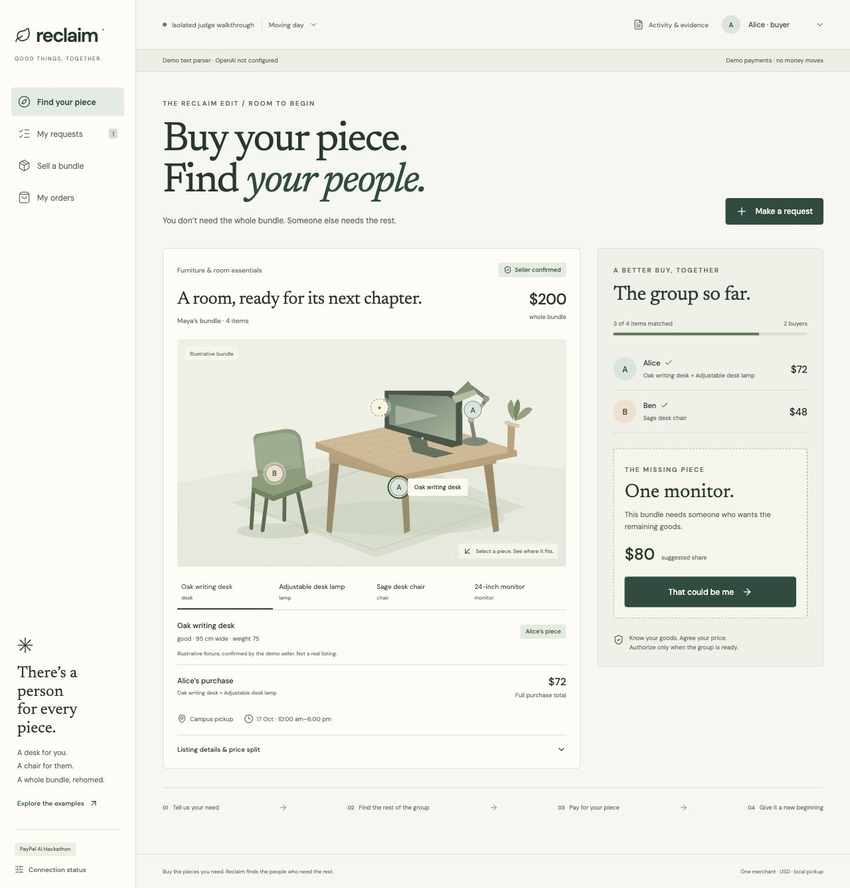
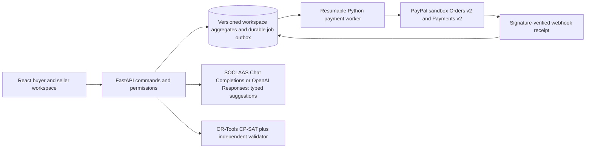

# Reclaim

**Buy the pieces you need. Reclaim finds the people who need the rest.**

A marketplace prototype for the [PayPal AI Hackathon](https://paypalaihackathon.devpost.com/). Buyers want different goods from a larger lot; Reclaim checks whether their requests can complete the entire purchase, then coordinates individual PayPal sandbox authorizations, captures and pickup orders.



## Run it locally

Requirements: Node.js 22.12+ and Python 3.12. macOS/Linux commands:

```sh
git clone https://github.com/kaseyho/Reclaim.git
cd Reclaim
python3.12 -m venv .venv
.venv/bin/python -m pip install -r backend/requirements-dev.txt
npm ci
cp .env.example .env
```

Terminal 1:

```sh
PYTHONPATH=backend .venv/bin/uvicorn reclaim.main:app --host 127.0.0.1 --port 8000
```

Terminal 2:

```sh
npm run dev
```

Open http://127.0.0.1:5173. API health: http://127.0.0.1:8000/api/health. Interactive API docs: http://127.0.0.1:8000/docs.

Without provider credentials, the app uses a **labelled deterministic text parser and simulated payments**. This is a functional local walkthrough, not proof of live AI or PayPal sandbox transactions. It exercises the same domain commands and persisted payment state machine. No money moves. AI and payment configuration are independent; a connected AI provider does not turn demo payments into sandbox payments.

To serve the production build through FastAPI instead of Vite, run `npm run build`, set `APP_URL=http://127.0.0.1:8000`, restart the API, and open port 8000.

## Judge walkthrough

1. Start with **Moving day**. Alice wants the desk and lamp; Ben wants the chair. The monitor is the missing demand.
2. Click **That could be me**. This selects Chen's separate walkthrough identity and opens an editable request. Interpret it, inspect the details, then confirm.
3. Review the completed group: **Alice $72, Ben $48, Chen $80**; the total is **$200**, including **$20 preparation**.
4. Click **Review group proposal**. Use **Viewing as** to accept independently as Alice, Ben, Chen and Maya, the seller.
5. Authorize each buyer's exact purchase. Demo mode says **Simulate authorization**. Connected mode opens the actual PayPal sandbox checkout.
6. Wait for all captures to be confirmed. As Maya, mark the individual orders ready.
7. Open **My orders** as a buyer. Inspect the receipt, enter that order's pickup code, and confirm collection. Problem reporting remains available.
8. Start another isolated example for creator equipment or bulk goods, or **Start fresh** to enter your own listings and requests.

The persona selector is deliberate **judge access**, not an impersonation feature for a production marketplace. Each persona has its own bearer token and server-checked permissions inside one isolated test workspace. A new example creates a new workspace. Live multi-merchant onboarding and production customer accounts are outside this sandbox prototype.

### Recovery walkthrough

Before authorizing a new group, view as Maya and open **Activity & evidence → Demo recovery lab**. Schedule **Fail Ben's next capture**. Alice's completed capture will be refunded; Ben's and Chen's authorizations will be voided. Pickup stays unavailable until cleanup completes.

**Lose Alice's capture response** demonstrates a completed provider operation with an uncertain application response. The durable retry reuses the same operation ID. **Block Alice's refund**, combined with a later capture failure, demonstrates reserved inventory and operator recovery instead of a false refund-success state.

The recovery lab is available only in demo mode. Its DEMO-prefixed results must not be presented as actual PayPal transaction evidence.

## Connect the actual providers

Follow [the account and configuration guide](docs/provider-setup.md). Required for the connected release:

- SOCLAAS key, API root and model for text/image extraction and request interpretation, or an OpenAI API key for the alternative Responses adapter. The supplied SOCLAAS `default` alias is supported through Chat Completions with local schema validation.
- PayPal sandbox app client ID and secret; one sandbox merchant and separate buyer accounts.
- A registered PayPal webhook and its ID.
- PostgreSQL for deployed, multi-process durability; Supabase's PostgreSQL is supported through its connection URL.
- Render or another Python-capable host for the API, worker and web build, or verified local setup instructions for judges.

Never commit `.env`, provider secrets, personal buyer credentials, or unredacted account recordings. PayPal client IDs are public SDK configuration; client secrets stay on the server.

## Architecture



Money is integer USD cents. Full requests, supply quantities, seller-confirmed attributes, locations, overlapping pickup windows, deadlines and budgets are hard constraints. Seller-confirmed reference weights define the price split; largest-remainder rounding conserves the exact total. A second validator rechecks every published allocation.

Proposals freeze terms, inventory/request versions and a terms hash. A reservation remains in place through authorization, capture and recovery. Payment outcomes come from PayPal; clients cannot set prices or mark purchases paid. Supported payment operations derive a stable `PayPal-Request-Id` from the immutable commitment and operation type.

The database stores domain records in transactional, versioned workspace aggregates, alongside relational membership, timed outbox and webhook tables. An independently committed payment journal records operation intent before every provider call, then stores provider outcomes; cancellation intent also survives an aggregate rollback. PostgreSQL locks a workspace row across processes. SQLite is only the single-process development adapter and uses both `reclaim.db` and `reclaim.journal.db`; preserve both when keeping local state. Worker jobs have leases, retries and generation counters so a later authorization cannot lose its wakeup while a job is running. Expiration is scheduled as a durable job.

## Verify

```sh
npm run verify
```

This builds TypeScript/Vite, runs the application Python suite, and checks the evaluation grader and offline benchmark. Application tests include property-based cent-rounding checks and small solver cases compared with exhaustive enumeration. Payment tests cover stale terms, concurrent proposals, incomplete approvals, lost responses, partial capture, failed refunds, expiry and restart.

GitHub Actions runs the full suite against PostgreSQL 16, then builds and starts the Docker image. Local SQLite checks pass 46 application tests with one PostgreSQL-only skip, including 13 provider-contract checks for routing, image encoding, validation, failure handling and credential privacy. The PostgreSQL suite includes that additional database test.

The [text evaluation pack](evaluation/README.md) freezes 30 synthetic listings and 60 synthetic requests independently of the runtime prompt. It includes an offline parser report, twelve scoring checks and explicit opt-in SOCLAAS/OpenAI evaluation commands. GitHub Actions checks the grader and runs the offline benchmark without either API key. These are unconfirmed proposal scores; representative photograph and human-session evidence remain pending.

Browser checks and their scope are recorded in [verification notes](docs/verification.md). Real provider credentials and actual sandbox approvals are separate integration gates; passing simulated tests does not establish them.

## Deploy

[Dockerfile](Dockerfile) builds the frontend and serves it with FastAPI. [render.yaml](render.yaml) prepares a Render service; set the environment entries from `.env.example`, use PostgreSQL, and configure a public `APP_URL` and matching `CORS_ORIGINS`.

One always-on API process can run the worker with `AUTO_WORKER=true`. To separate the worker, set `AUTO_WORKER=false` on the API and run `PYTHONPATH=backend python -m reclaim.worker` in a background service with the same database and provider configuration. PostgreSQL is required for separate processes. The local SQLite process lock does not coordinate multiple server/worker processes.

The blueprint does not authorize a purchase or create a cloud account by itself. Review the hosting plan and retention requirements before creating paid services. Judges need access through the end of judging on 16 December 2026, 00:00 Singapore time; free resources that expire earlier need an explicit alternative.

## Submission materials

- [Devpost write-up](docs/submission/devpost.md)
- [Talking-head script](docs/submission/demo-script.md)
- [Timed shot list](docs/submission/storyboard.md)
- [Actual app gallery and captions](docs/submission/gallery/README.md)
- [Build requirements](docs/build-plan.md)

The final video must be publicly visible on YouTube and under three minutes. Hosted deployment, real provider evidence, final video, and Devpost submission are tracked separately; prepared files do not imply that an entry was submitted.

## Assets and licence

The existing MIT [LICENSE](LICENSE) is retained. Listing fixtures and SVG illustrations are original, fictional demo content. [Third-party notices](THIRD_PARTY_NOTICES.md) cover the bundled fonts and icons. No real user research, observed savings, environmental claims, or AI precision percentages are asserted without evidence.
